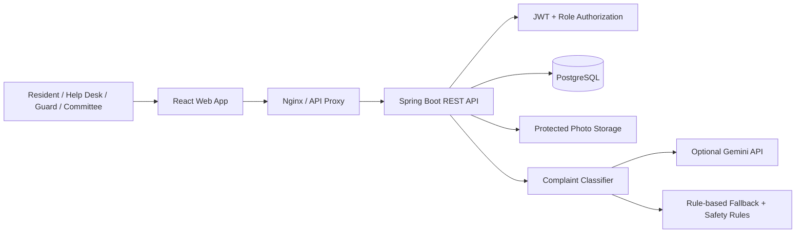

# Gated Township Management System

A full-stack resident and facility-management platform for a gated township in Pune, India. The application brings resident services, maintenance operations, gate security, shared amenities, society communications, and committee reporting into one role-based web application.

**Repository:** [RealRajat/gated-township-management-system](https://github.com/RealRajat/gated-township-management-system)  
**Live demo:** Not publicly deployed yet. The application is currently documented for local and Docker-based deployment.

> **Project context:** The reference township in the brief has 28 towers and approximately 2,400 apartments. Sample records are seeded for development and evaluation; they are not live resident data.

## What the application includes

| Area | Capabilities |
|---|---|
| Authentication & access | JWT-based sign-in, resident-to-flat association, and role-based access for Residents, Help Desk, Guards, and Committee users |
| Maintenance & ledger | Area-based monthly maintenance bills, balances, bill history, and flat ledger |
| Payments | Mock/test-mode payments, receipts, partial payments, and duplicate/overpayment safeguards; no real funds are charged |
| Bank reconciliation | CSV statement import, transaction matching, duplicate handling, and manual review for ambiguous entries |
| Complaints | Complaint lifecycle, staff assignment, activity history, photo attachments, SLA tracking, and resident ratings |
| AI-assisted triage | Complaint category/urgency suggestions with deterministic rule-based fallback and safety-keyword escalation |
| Visitor & gate operations | Pre-approved visitors, resident approval for walk-ins, guard check-in/check-out, pass validation, and queued offline actions |
| Amenities | Facility catalogue, slot availability, capacity limits, bookings, and cancellation |
| Notices | Township-wide or tower-targeted announcements, priority/pinning, expiry, and read receipts |
| Committee analytics | Financial collection and dues ageing, complaint performance, operational summaries, and CSV exports |

## User roles

- **Resident:** View bills and ledger, make test payments, reconcile-facing payment history, raise complaints, manage visitors, book amenities, and read notices.
- **Help Desk:** Manage operational workflows including billing administration, bank reconciliation, complaints, visitor oversight, notices, and amenity administration.
- **Gate Guard:** Verify visitor passes and record visitor entry/exit using the gate workflow.
- **Committee:** View society-level financial and operational analytics and download reports.

Access is enforced by backend authorization rules; frontend route visibility is not the security boundary.

## Technology stack

| Layer | Technology |
|---|---|
| Frontend | React 19, Vite 8, Tailwind CSS 4, React Router 7, Recharts |
| Backend | Java 17, Spring Boot 4.1.2, Spring Security, Spring Data JPA |
| Authentication | JWT (JJWT 0.12.6), BCrypt password hashing |
| Database | PostgreSQL 16, Flyway migrations |
| Build & runtime | Maven Wrapper, npm, Docker, Docker Compose, Nginx |
| AI classification | Optional Gemini integration with rule-based fallback and mandatory safety overrides |

## Architecture at a glance



The backend is a modular Spring Boot application backed by PostgreSQL. Flyway manages schema changes through migrations V1–V8. The frontend communicates with the backend through REST APIs.

## Repository layout

```text
.
├── README.md
├── deployment.md
├── Technical_Design_Document.pdf
├── Technical_Design_Document.md
├── FINAL_PROJECT_AUDIT.md
├── township-management/
│   ├── backend/          # Spring Boot API, migrations, tests
│   ├── frontend/         # React application
│   ├── docs/             # Architecture, API and database documentation
│   └── sample-data/      # Development township seed/configuration
└── .gitignore
```

## Run locally

For the complete prerequisites, environment-variable list, database setup, demo accounts, Docker instructions, and troubleshooting, follow **[deployment.md](./deployment.md)**.

Quick outline:

1. Install Java 17, Node.js/npm, and PostgreSQL 16.
2. Create the PostgreSQL database and configure the environment variables listed in `deployment.md`. Never commit a real `.env` file or secret.
3. Start the backend:

   ```powershell
   cd township-management\backend
   .\mvnw.cmd spring-boot:run
   ```

4. In a second terminal, start the frontend:

   ```powershell
   cd township-management\frontend
   npm install
   npm run dev
   ```

5. Open [http://localhost:5173](http://localhost:5173). The backend health endpoint is [http://localhost:8080/api/health](http://localhost:8080/api/health).

Flyway applies the database migrations when the backend starts, provided the configured database is reachable and the application has the required permissions.

## Run tests and build

Backend tests:

```powershell
cd township-management\backend
.\mvnw.cmd test
```

Frontend production build:

```powershell
cd township-management\frontend
npm ci
npm run build
```

## Important implementation boundaries

- Payments are simulated in **test mode**; the project does not charge real money.
- Bank transactions that cannot be matched confidently are routed for manual review rather than automatically posted.
- Safety-related complaint keywords trigger rule-based escalation; an AI suggestion must not downgrade that escalation.
- Gemini is optional. When its API key is unavailable, the rule-based classifier is used.
- Gate offline actions are queued in browser storage and synchronized later. This is a prototype workflow, not a substitute for a hardened offline-first security architecture.
- Visitor-photo retention is configured for a 90-day cleanup policy; production operations must verify scheduled cleanup and storage controls.
- No public production URL is currently available. Localhost URLs are for development only.

## Security and demo data

The repository is intended for evaluation and development. Seeded demo accounts and default passwords, where documented in `deployment.md`, are **development-only**. Do not expose them on a public production deployment. Disable development seeding, rotate credentials, configure strong secrets, restrict CORS, and review storage/database permissions before deployment.

Do not upload real resident personal information, production credentials, payment data, or visitor photographs to this repository.

## Project documentation

- [Technical Design Document (PDF)](./Technical_Design_Document.pdf)
- [Technical Design Document (Markdown)](./Technical_Design_Document.md)
- [Deployment and local setup guide](./deployment.md)
- [Final project audit](./FINAL_PROJECT_AUDIT.md)
- [Detailed application README](./township-management/README.md)
- [Architecture overview](./township-management/docs/architecture.md)

## Assumptions and scope

This is an evaluation implementation based on the supplied township problem statement and seeded sample data. External payment rails, production OTP delivery, physical gate hardware/CCTV integrations, and a publicly hosted production environment are not represented as completed live integrations. See the Technical Design Document for assumptions, trade-offs, and limitations.
