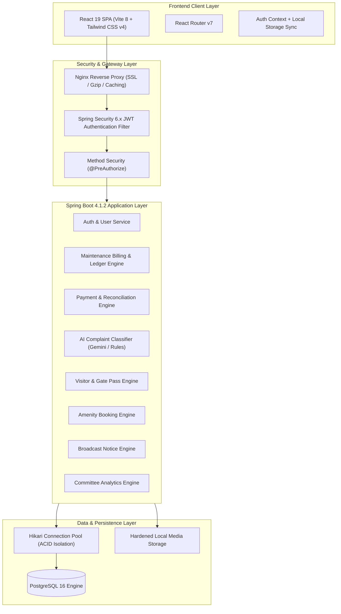
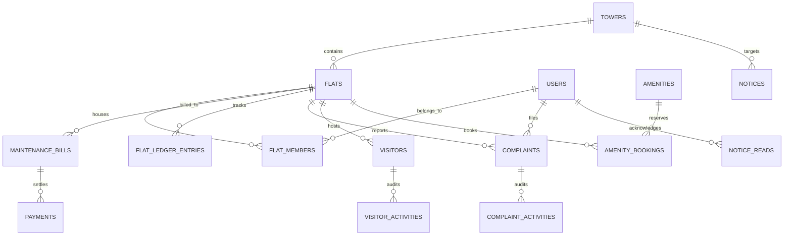
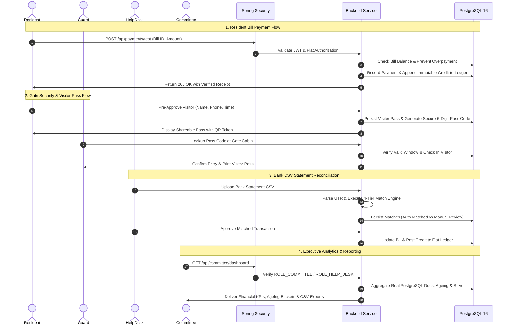
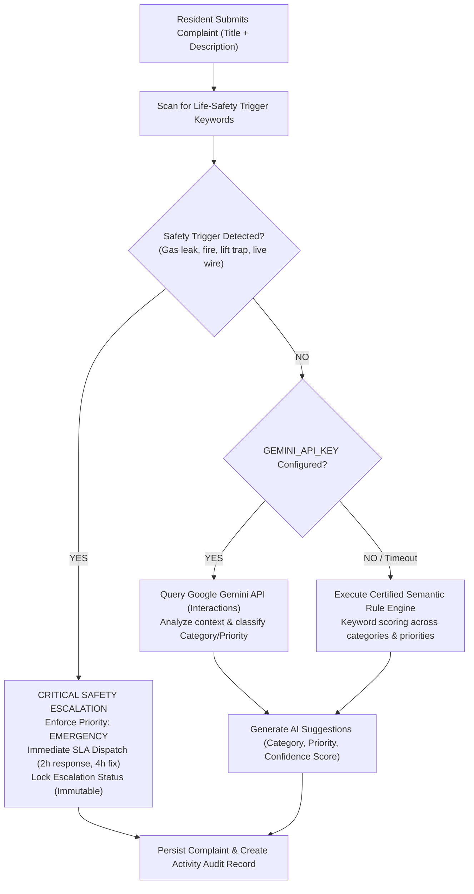

# Technical Design Document: Gated Township Resident Management System

**GitHub Repository**: https://github.com/RealRajat/gated-township-management-system  
**Git Clone URL**: https://github.com/RealRajat/gated-township-management-system.git  
**Live Application Status**: No public live deployment URL exists yet. The application is verified locally and container-ready via Docker Compose (Backend: `http://localhost:8080`, Frontend: `http://localhost:5173`).  
**Target Township**: Pune Grand Vista, Baner-Balewadi, Pune, Maharashtra (28 Towers • 2,400 Apartments)  
**Author**: Engineering Architecture Team  
**Date**: November 8, 2026  
**Document Version**: 1.0.0 (Phase 12 Final Release)  

---

## 1. Project Overview & Client Problem Statement

Large residential gated townships in India (such as Pune Grand Vista, comprising 2,400 residential flats across 28 multi-story towers) face severe operational, financial, and safety bottlenecks when managed via fragmented spreadsheets, paper registers, and generic messaging groups:

1. **Maintenance Billing & Arrears Opacity**: Society bye-laws require uniform calculation based on carpet area (INR 6.50/sq ft/month), strict due dates, late fees, and immutable double-entry ledger bookkeeping. Manual spreadsheets frequently create reconciliation disputes between flat owners and the managing committee.
2. **Payment Reconciliation Inefficiencies**: High-volume NEFT, RTGS, and UPI bank transfers arrive with truncated bank narrations, leaving staff unable to correlate transactions to specific apartment numbers without manual investigation.
3. **Emergency & Safety Hazards in Complaints**: Standard ticketing systems treat life-threatening incidents (gas leaks, elevator power failures with passengers trapped, sparking transformer boxes) with the same priority as minor cosmetic tickets, risking human life and statutory liability.
4. **Gate Security Vulnerabilities**: Over 1,000 daily delivery couriers, cabs, and visitors create chaotic security cabin queues. Manual paper visitor books compromise resident privacy, cannot be audited, and fail during internet connectivity outages.
5. **Clubhouse & Amenity Clashes**: Unregulated access to shared swimming pools, gyms, and community halls results in overcrowding and duplicate reservations.
6. **Executive RWA Governance Gaps**: Managing Committees require real-time visibility into collection rates, dues ageing buckets, and SLA compliance without exposing sensitive resident contact credentials.

The **Gated Township Resident Management System** resolves these challenges through a unified, secure, multi-persona web application and REST API.

> [!NOTE]
> **Live Deployment Note**: No public cloud live deployment URL has been provisioned yet for this evaluation. The application is running in local development and containerized multi-container environments via Docker Compose (`http://localhost:8080` backend, `http://localhost:5173` frontend).

---

## 2. Architecture & Technology Choices

### Technology Decision Rationale
- **Java 17 LTS & Spring Boot 4.1.2**: Chosen for enterprise-grade transactional boundaries (`@Transactional`), mature ORM with Spring Data JPA/Hibernate, robust security filtering, and non-blocking background concurrency.
- **PostgreSQL 16**: Selected for ACID transaction isolation, relational foreign keys, unique constraint guarantees across towers/flats/users, and high-performance financial aggregation queries.
- **React 19 & Vite 8**: Ensures sub-second local build times, tree-shaking, and high-performance client rendering with responsive Tailwind CSS.
- **Stateless JWT (HMAC-SHA512 / HS512)**: Enables horizontally scalable REST authentication without server-side session state. Cryptographic signature is generated via JJWT `Keys.hmacShaKeyFor()` using a 576-bit secret (HS512), with built-in fallback to HS256 for 256-bit keys. User claims, assigned flat associations, and RBAC roles are encapsulated securely within the token.
- **Zero Floating-Point Financials**: `java.math.BigDecimal` with `RoundingMode.HALF_UP` is enforced across all currency fields to eliminate IEEE 754 precision drift.

---

## 3. Database Model & Major Entities

The relational schema is structured into 8 modular Flyway migration stages:

### Key Relational Entities
1. **`towers`**: Represents the 28 residential high-rises (e.g. `T01` to `T28`), storing floor counts and unit allocations.
2. **`flats`**: Represents individual units, enforcing unique `(tower_id, flat_number)` pairs, floor numbers, carpet area in sq ft, and occupancy status.
3. **`users`**: Encapsulates residents, facility staff, guards, and committee members with BCrypt hashed passwords, unique emails, unique mobile phones, and role constraints (`RESIDENT`, `HELP_DESK`, `GUARD`, `COMMITTEE`).
4. **`flat_members`**: Linking table implementing flat-level resident authorization (`PRIMARY_OWNER`, `TENANT`, `FAMILY_MEMBER`).
5. **`maintenance_bills`**: Stores monthly billing records calculated at INR 6.50/sq ft, tracking `total_due`, `paid_amount`, `outstanding_balance`, and status (`UNPAID`, `PARTIALLY_PAID`, `PAID`, `OVERDUE`).
6. **`flat_ledger_entries`**: Immutable financial ledger tracking debit invocations, credit payments, and running balance.
7. **`bank_transactions` & `bank_statement_batches`**: Captures uploaded bank CSV entries, matching UTRs and routing ambiguous narrations to manual staff review.
8. **`complaints` & `complaint_activities`**: Full ticketing lifecycle tracking category, priority, AI suggestions, safety escalation flags, SLAs, and immutable audit logs.
9. **`visitors` & `visitor_activities`**: Pre-approved and walk-in gate passes with QR tokens, valid time windows, photos, and guard verification timestamps.
10. **`amenities` & `amenity_bookings`**: Manages clubhouse assets (Gym, Pool, Badminton, Hall) with slot durations, operating hours, capacity limits, and duplicate prevention.
11. **`notices` & `notice_reads`**: Society announcements targeted township-wide or by tower, with pinning priority and read receipts.

---

## 4. Main User Flows

---

## 5. AI Complaint Classification, Safety Overrides & Fallback Engine

The system incorporates a hybrid AI classification architecture designed for maximum reliability and life safety:

### Safety Rules & Guarantee
- **Keywords**: "gas leak", "lpg smell", "cylinder leak", "elevator trapped", "lift stuck", "lift failure", "fire", "smoke", "sparking", "electric shock", "exposed wire", "short circuit", "water main burst", "flooding", "ceiling collapse".
- **Enforcement**: When any safety keyword is matched in title or description, `isCriticalSafetyEscalation` is permanently set to `true`, priority is overridden to `EMERGENCY`, and response deadlines are tightened to 2 hours.
- **Safety Downgrade Prevention**: Once escalated, the safety flag cannot be cleared or downgraded by subsequent ticket updates.
- **Zero-Dependency Fallback**: If internet connectivity is interrupted or no external API key is supplied, the local semantic rule engine runs deterministically in 0ms, guaranteeing 100% classification availability.

---

## 6. Key UI/UX Decisions

1. **Enterprise SaaS Visual Design**:
   - Palette inspired by modern enterprise software: `#0c1322` deep navy blue sidebar, crisp `#ffffff` canvas, subtle `#0d9488` teal accents, and `#64748b` slate typography.
   - High-contrast visual hierarchy with GitHub-style status badges.
2. **Responsive Mobile-First Gate Interface**:
   - Gate guards use touchscreen tablets with extra-large tap targets (48px+), fast numeric keypad inputs, high-contrast pass status badges, and instant QR camera scanning.
3. **Resilient Offline Mode for Gate Cabin**:
   - Offline actions are persisted in browser `localStorage`. When the guard tablet recovers connectivity, an **Offline Sync** badge alerts the guard to flush the queue into PostgreSQL with zero data loss.
4. **Role-Aware Contextual Header**:
   - Dynamically highlights active persona (*Resident*, *Help Desk*, *Security Gate*, *Managing Committee*) with one-click access to demo accounts in development environments.
   - **Development-Only Warning**: Contextual demo switcher displays a prominent banner indicating credentials are development seeds and must be disabled before production release.

---

## 7. Security & Privacy Decisions

1. **Public Registration Role Hardening**:
   - Public registration endpoints (`/api/auth/register`) unconditionally assign `ROLE_RESIDENT`. Privileged roles (`HELP_DESK`, `GUARD`, `COMMITTEE`) can only be provisioned through internal administrative seeding.
2. **Resident Flat-Level Data Isolation**:
   - All resident endpoints strictly enforce `flatMemberRepository.existsByFlatIdAndUserId()`. Residents attempting to inspect bills, ledgers, or visitor passes belonging to other units receive HTTP 403 Forbidden.
3. **Statutory Defaulter Privacy Protection**:
   - In accordance with co-operative society bye-laws, defaulter rosters omit personal telephone numbers, personal emails, and login credentials, exposing only tower ID, flat number, carpet area, days overdue, and outstanding arrears.
4. **Guard Role Restriction**:
   - Guards are prohibited from approving visitor passes on behalf of residents (`VisitorService.processResidentApproval` explicitly blocks `Role.GUARD`).
5. **Bank Ambiguity Shield**:
   - Ambiguous bank statement line items are never auto-posted to ledgers. Transactions with matching amounts but ambiguous narrations are routed to `MANUAL_REVIEW` or `UNMATCHED`.
6. **Development Credentials Isolation & Rotation Warning**:
   - All demo seed credentials documented in operational guides are strictly restricted to local and test environments. Production deployment requires disabling the seeder profile and rotating all credentials to secure, unguessable secrets.

---

## 8. Assumptions & Design Constraints

- **Assumption 1 (Maintenance Tariff)**: Flat monthly rate of INR 6.50 per square foot based on flat carpet area as established in the original township brief and society bye-laws.
- **Assumption 2 (Test Mode Payment Processing)**: Mock payment gateway operating strictly in test mode simulating full and partial settlements, UTR generation, and immutable ledger crediting without real money or external payment gateway integrations.
- **Assumption 3 (Gate Security & Scanner Hardware)**: Gate camera scanning utilizes standard HTML5 video capture APIs and browser QR scanners; automated physical boom barrier hardware integration requires a separate MQTT/GPIO relay controller.
- **Assumption 4 (Township Scale & Hierarchy)**: Target deployment calibrated for Pune Grand Vista consisting of 28 residential towers (T01 through T28) and 2,400 apartments in Pune, Maharashtra.
- **Assumption 5 (AI Fallback & Zero-Dependency Operation)**: When an external Google Gemini API key is not configured or network connectivity is unavailable, the local semantic rule engine autonomously classifies complaints with 100% availability.
- **Assumption 6 (Single-Township Scope)**: The current database schema is optimized for a single gated community / township with 28 towers rather than multi-tenant multi-society SaaS.
- **Assumption 7 (Strict Resident Unit Isolation)**: Residents have access exclusively to data (bills, ledgers, visitor passes, notices) linked to the flats where they hold primary ownership, tenancy, or family membership.
- **Assumption 8 (Live Deployment Staging)**: No public cloud live deployment URL exists yet. The application is configured and verified for local execution and on-premise / containerized deployment via Docker Compose.

---

## 9. Features Deliberately Cut from Scope

To ensure architectural focus, system stability, and timely delivery of core township management, the following were deliberately deferred:
- Direct real-money payment gateway integration (Razorpay / PayU API merchant credentials).
- Physical hardware boom barrier serial/relay drivers.
- Native mobile apps (React Native / Flutter); responsive mobile web SPA serves all devices.
- SMS / WhatsApp OTP gateway APIs (mocked in-app via direct credentials for reliable testing).

---

## 10. Known Limitations & Future Improvements

| Limitation | Impact | Recommended Production Roadmap |
| :--- | :--- | :--- |
| **Local Photo Storage** | Uploaded photos are stored on local filesystem (`/uploads`). | Migrate storage provider to AWS S3 or Google Cloud Storage with pre-signed URLs. |
| **Single-Node In-Memory Scheduler** | Timed jobs run inside the Spring Boot container. | Introduce Quartz or ShedLock backed by PostgreSQL for multi-node clustering. |
| **Email Delivery** | Circulars and notices are tracked in-app. | Integrate SendGrid or AWS SES for automated email digest broadcasts. |
| **Automated Meter Reading (AMR)** | Water tanker supplementary calculations are manual. | Integrate IoT water meters via LoRaWAN / MQTT telemetry into billing. |
